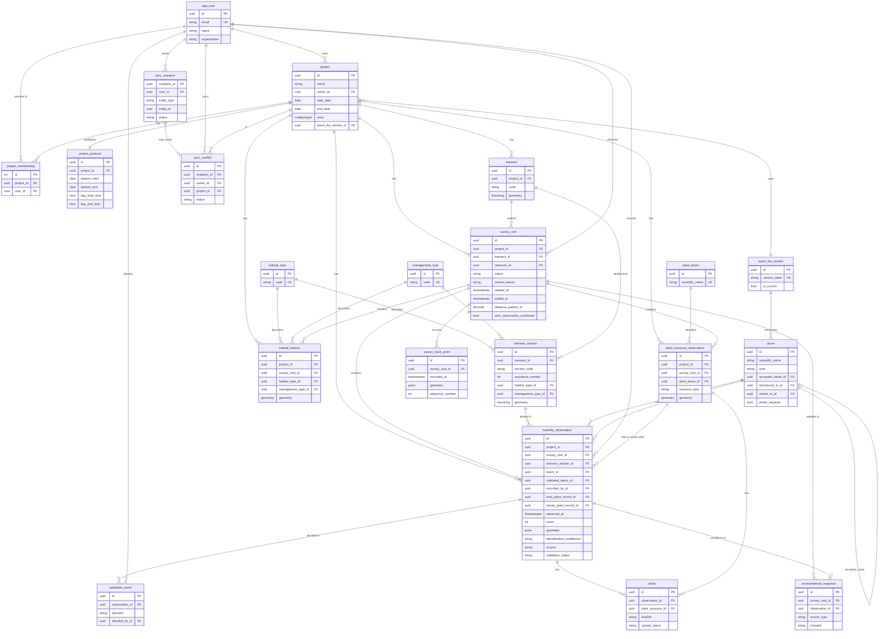

# ER diagram (Phase 1)

Table names are the `db_table` values. Key columns only; the full list is in [fields.md](fields.md).
Synced tables also carry the sync columns (`server_version`, `created_at`, `updated_at`,
`deleted_at`, `created_by_id`, `updated_by_id`). History tables (`historical_<table>`) are omitted.

Not shown: the `geo` views (T067), `report_transect_indicators` (T061), and the Phase 2 tables
`sensor_station_link`, `focal_follow_*` and `trajectory_event`.
