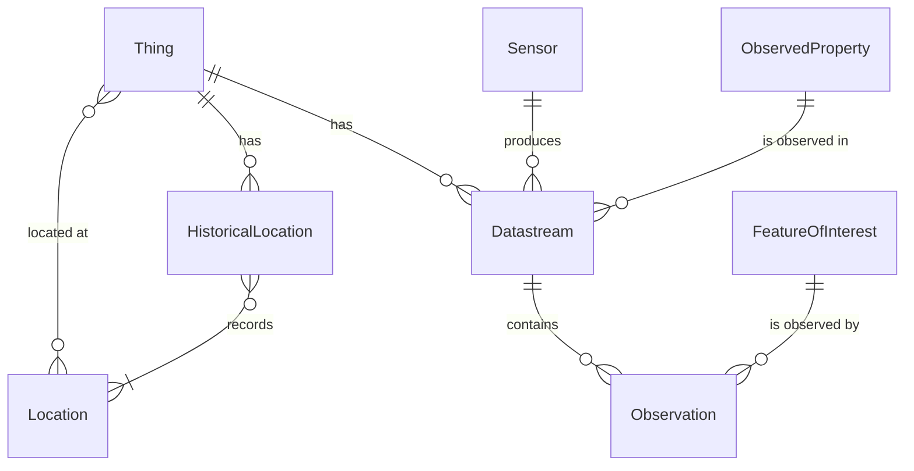
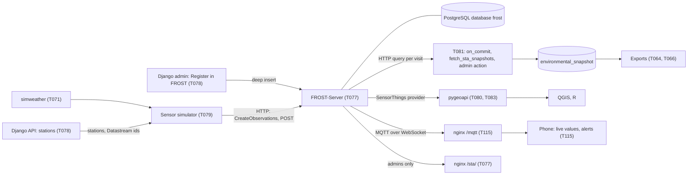

# OGC SensorThings API: study note (T076)

This note describes the OGC SensorThings API (STA) 1.1 and how Phase 2 will use it. It fixes the
mapping that T077–T081 and T115 build, and it is the basis of the SensorThings chapter in thesis
Part 2. **Nothing in E12 is built yet.** Every "T0xx does …" below is a plan, and every station
value is **simulated** ([D-018](../DECISIONS.md)). Facts were checked on 2026-11-25. The sources
are listed in §11; the working notes with page numbers are in `tmp/t076/notes.md` (not committed).

## 1. Purpose and scope

The development plan asks how temperature, wind, cloud and sunshine affect butterfly activity and
detectability (§4, question 2). In Phase 1 the only weather is what the observer writes on the
visit form (T063 stores it as `manual` snapshots). Phase 2 adds microclimate stations, so that each
visit also gets measured values. STA is the OGC standard for exactly this kind of data: sensors,
their time series and their observations.

| In scope | Out of scope |
|---|---|
| STA 1.1 Part 1 (Sensing): entity model, REST API, deep insert, DataArray, MQTT | STA Part 2 (Tasking, actuators) |
| FROST-Server as the STA server (T077) | Real sensors: there are none (D-018) |
| Simulated stations registered from Django admin (T078) and fed by a simulator (T079) | A microclimate model: the simulator is "a statistical toy" (T079) |
| Stations as OGC API – Features collections (T080), snapshots per visit (T081) | EDR, which has its own note (T082) |
| Live values on the phone over MQTT (T115) | OGC write access through pygeoapi |

## 2. SensorThings API 1.1 in brief

STA 1.1 (OGC 18-088, 2021) is a REST API over JSON with an OData-style query language. A URL has
three parts: the service root with the version (`http://frost:8080/FROST-Server/v1.1`), a resource
path (`Datastreams(12)/Observations`) and query options. Every entity carries `@iot.id`,
`@iot.selfLink` and navigation links to related entities.

| Feature | What it does | Used by |
|---|---|---|
| `$filter`, `$orderby`, `$top`, `$select` | Filter and sort entity sets; ISO 8601 time literals | T081, T080 |
| `$expand` | Inline related entities in one response | T080 (`sta-datastreams`) |
| Paging (`@iot.nextLink`) | A server limit overrides a larger `$top`; clients must follow `nextLink` | T081 |
| Deep insert | One POST creates an entity and its related entities, all or nothing | T078 |
| DataArray (`CreateObservations`) | Many Observations per request, compact rows | T079 backfill |
| MQTT extension | Subscribe to changes; optionally create Observations by publish | T115 |
| Batch (`$batch`) and MultiDatastream | Several requests in one; vector-valued Datastreams | Not used |

### STA 2.0

OGC published **SensorThings API 2.0** (OGC 23-019) on 2026-11-04. It bases the model on the new
Observations, Measurements and Samples standard (ISO 19156:2023), renames FeatureOfInterest to
`Feature`, lets a Datastream link the Feature it observes, replaces `observationType` and
`unitOfMeasurement` with SWE Common `resultType`, drops MultiDatastream, renames `@iot.id` to `id`,
and models time intervals as objects. Batch and DataArray moved to an extension document that is
not published yet.

This project stays on **1.1**:

1. The T076 criterion and T077–T083 are written against 1.1.
2. T079's backfill needs DataArray, which has no published 2.0 form.
3. FROST 2.8 can serve 2.0, but only behind plugins that are off by default. pygeoapi 0.24.0's
   SensorThings providers hard-code the 1.1 names (`@iot.id`, `@iot.nextLink`,
   `FeaturesOfInterest`), so they cannot read a 2.0 server.

Moving to 2.0 is future work. The Datastream-level feature of interest in 2.0 fits this project's
habitat model better than 1.1 does (§4).

## 3. Entity model

STA 1.1 has eight sensing entities.

| Entity | Meaning in the standard | Required properties |
|---|---|---|
| Thing | "an object of the physical world (physical things) or the information world (virtual things)" that can join a network | `name`, `description` (+ free `properties`) |
| Location | The last known location of a Thing | `name`, `description`, `encodingType` (GeoJSON), `location` |
| HistoricalLocation | When a Thing was at which Location | `time` |
| Sensor | The instrument that produces the estimates | `name`, `description`, `encodingType`, `metadata` |
| ObservedProperty | The phenomenon being observed | `name`, `definition` (URI), `description` |
| Datastream | Observations of one ObservedProperty by one Sensor on one Thing | `name`, `description`, `unitOfMeasurement`, `observationType` |
| Observation | One act of measuring | `phenomenonTime`, `result`, `resultTime` |
| FeatureOfInterest | The feature whose property was observed | `name`, `description`, `encodingType`, `feature` |



*Diagram 1. STA 1.1 sensing entities and their cardinalities (OGC 18-088 Figure 2, Tables 4–21).*

**Location vs FeatureOfInterest.** The Location is where the Thing is. The FeatureOfInterest is
what the observation describes. For an in-situ sensor the two are often the same, but the standard
says "the ultimate location of interest of a Thing is not always the location of the Thing". If an
Observation is created without a FeatureOfInterest, the server makes one from the Thing's Location.
In 1.1 the FeatureOfInterest is linked **only to Observations**, never to the Thing or the
Datastream.

**HistoricalLocation** is created by the server whenever a Thing gets a new Location (Requirement 8),
and clients do not create the current one. Manual creation exists only for importing history.

## 4. Mapping to this project

| STA entity | Project concept | Created by | Stored in Django |
|---|---|---|---|
| Thing | A simulated microclimate station; `properties` {`project_id`, `habitat_type`, `simulated: true`} | T078 deep insert | `SensorStationLink.sensorthings_thing_id` |
| Location | The station point (`SensorStationLink.geometry`) | T078 deep insert | — |
| HistoricalLocation | Made by FROST when the Location is linked; stations do not move | FROST | — |
| Sensor | One "Virtual microclimate sensor v1", `encodingType` `text/plain`, metadata describing the simulation | T078 | — |
| ObservedProperty | Four, shared by all stations, created once (table below) | T078 | — |
| Datastream | Four per station, 10-minute, `OM_Measurement` (double results), `properties.simulated = true` | T078 deep insert | `sensorthings_datastream_ids` {property: id} |
| Observation | One simulated value | T079 | Copied into snapshots by T081 |
| FeatureOfInterest | The habitat polygon if the station is linked to one, otherwise the station point | T078 (separate POST), linked by T079 | `metadata_json["sensorthings_foi_id"]` (D-117) |

| ObservedProperty | `definition` (CF standard name, NERC URI) | Unit (UCUM) | Snapshot column |
|---|---|---|---|
| Air temperature | `https://vocab.nerc.ac.uk/standard_name/air_temperature/` | degree Celsius, `°C`, `Cel` | `temperature_c` |
| Relative humidity | `https://vocab.nerc.ac.uk/standard_name/relative_humidity/` | percent, `%`, `%` | `relative_humidity_pct` |
| Wind speed | `https://vocab.nerc.ac.uk/standard_name/wind_speed/` | metre per second, `m/s`, `m/s` | `wind_speed_m_s` |
| Global solar radiation | `https://vocab.nerc.ac.uk/standard_name/surface_downwelling_shortwave_flux_in_air/` | watt per square metre, `W/m²`, `W/m2` | `solar_radiation_w_m2` |

The CF canonical units are K, 1, m s-1 and W m-2. CF accepts any convertible unit, and STA carries
the unit in each Datastream, so °C and % are kept to match the visit form.

**The development plan's example, adapted.** The plan (§9.2) uses one station, "Stanica T01 —
suva livada" (station T01, dry grassland). Adapted to this project:

| Entity | Example |
|---|---|
| Thing | "S01 — dry grassland (simulated)", `properties` {`project_id`, `habitat_type`: dry grassland, `simulated`: true} |
| Location | The station point, GeoJSON |
| Sensor | "Virtual microclimate sensor v1" (one for all four quantities, not one per quantity as in the plan) |
| ObservedProperty | Air temperature (CF `air_temperature`) |
| Datastream | "S01 air temperature, 10 min", unit `°C` |
| Observation | 27.4 °C, `phenomenonTime` `2026-07-15T09:20:00Z` (11:20 local, CEST = UTC+2) |
| FeatureOfInterest | The dry-grassland habitat polygon S01 stands in |

Three changes from the plan: "sunshine" (a duration) becomes global radiation (a flux in W/m²);
every entity is labelled simulated; and the time is a full UTC timestamp, as STA and
[CONVENTIONS A.5](../CONVENTIONS.md) require.

**Deep insert (T078), shortened:**

```json
POST /v1.1/Things
{
  "name": "S01 — dry grassland (simulated)",
  "description": "Simulated microclimate station",
  "properties": {"project_id": "<uuid>", "habitat_type": "dry grassland", "simulated": true},
  "Locations": [{"name": "S01", "description": "Station point",
                 "encodingType": "application/geo+json",
                 "location": {"type": "Point", "coordinates": [20.46, 44.81]}}],
  "Datastreams": [{
    "name": "S01 air temperature, 10 min",
    "description": "Simulated, 10-minute",
    "unitOfMeasurement": {"name": "degree Celsius", "symbol": "°C",
                          "definition": "http://unitsofmeasure.org/ucum.html#para-30"},
    "observationType": "http://www.opengis.net/def/observationType/OGC-OM/2.0/OM_Measurement",
    "properties": {"simulated": true},
    "Sensor": {"@iot.id": 1},
    "ObservedProperty": {"@iot.id": 1}
  }]
}
```

The other three Datastreams follow the same pattern. The shared Sensor and ObservedProperties are
linked by id. A deep insert is all or nothing, and running it again creates a second set, so T078's
"re-run updates" means PATCH requests on the stored ids.

**Two consequences of the 1.1 model for later tickets:**

- **The habitat polygon has to be linked per Observation.** T078 cannot attach a
  FeatureOfInterest to the Thing or the Datastreams. It creates the FeatureOfInterest with its own
  POST and stores the id in `metadata_json["sensorthings_foi_id"]`, which needs no schema change
  ([D-117](../DECISIONS.md)). T079 then sends `FeatureOfInterest/id` in every DataArray row. If
  it doesn't, FROST quietly creates a point feature from the station Location.
- **T079 posts instants, with an empty `resultTime`.** 1.1 has no interval functions in `$filter`,
  so T081's time filter is only exact for instant `phenomenonTime`s. pygeoapi's EDR provider uses
  `resultTime` before `phenomenonTime`, so a backfill with `resultTime` set to the posting time
  would show the wrong dates.

**Snapshots (T081).** For a visit, T081 picks a station (linked to the visit's transect, otherwise
the nearest active one within 5 km) and asks FROST for each Datastream:

```
Datastreams(<id>)/Observations?$filter=phenomenonTime ge 2026-07-15T08:30:00Z
  and phenomenonTime le 2026-07-15T09:45:00Z&$orderby=phenomenonTime&$top=1000
```

It follows `@iot.nextLink` if present. It writes three `EnvironmentalSnapshot` rows (`visit_mean`,
`start`, `end`) with `source_type = sensorthings`, `source_uri` = the query URL,
`is_simulated = true` (the model default is false), the raw responses in `raw_payload_json`, and a
new `station_link` FK. A snapshot row is wide (one column per quantity), so the four Datastreams
are merged into one row per moment. The `visit_mean` row uses `phenomenon_time_start` and
`phenomenon_time_end` as an interval. The unique constraint `env_snapshot_unique_visit_moment`
allows one `sensorthings` row per visit and moment, so a transect with several linked stations
needs a rule for picking one.

## 5. FROST-Server

FROST-Server (Fraunhofer IOSB) is the reference open-source STA server, written in Java on Tomcat
with PostgreSQL/PostGIS.

| Item | Decision for T077 | Why |
|---|---|---|
| Image | `fraunhoferiosb/frost-server:2.8.2` (all-in-one: HTTP + MQTT) | Newest GitHub release (2026-10-25). `2.8.3` is on Docker Hub without notes; `latest` is a 2.9.0 snapshot. The pin needs the developer's OK (CLAUDE.md) |
| Database | Own database `frost`, role `frost`, `CREATE EXTENSION postgis` | [D-004](../DECISIONS.md): FROST's Liquibase migrations stay away from Django's |
| Schema updates | `persistence_autoUpdateDatabase=true` | Otherwise someone has to click "upgrade" on `/DatabaseStatus` |
| Ids | Defaults: `plugins_coreModel_idType=LONG`, `persistence_idGenerationMode=ServerGeneratedOnly` | No extra extension; Django already stores ids as strings (`varchar(64)`) |
| Plugins | DataArray and BatchProcessing on (defaults); MultiDatastream, Actuation, OData and V2 off; OpenAPI optional | DataArray is needed by T079 |
| MQTT | **On** (`mqtt_Enabled=true`), ports 1883 and 9876 not published (see §7) | Changed from T077's "MQTT disabled" |
| Paging | `defaultTop` 100, `maxTop` 10000 (defaults); raise `defaultTop` if EDR needs longer ranges (§6) | T081's `$top=1000` is below `maxTop` |
| Memory | About 768 MB heap via Tomcat's `JAVA_OPTS` (verify in T077) | E12 risk note: 0.5–1 GB |

Settings are environment variables with dots replaced by underscores (`persistence.db.url` →
`persistence_db_url`). T077 can check what the server supports in the `serverSettings.conformance`
list on the service root.

**Root URL and nginx.** Inside Compose, FROST answers at `http://frost:8080/FROST-Server/v1.1`
(Tomcat's context path). From outside, nginx serves it at `/sta/`, with the same admin-only
`auth_request` as `/ogc/`. FROST writes absolute `selfLink`s and `nextLink`s from `serviceRootUrl`.
A fixed external root would send internal clients (T081, the simulator) to `localhost`, which is
their own container. The recommended setup leaves `serviceRootUrl` empty, enables
`http_requestDecoder_autodetectRootUrl` and `…useXForwardedHeaders`, and has nginx send
`X-Forwarded-*` headers. Internal services reach FROST directly without auth.

## 6. pygeoapi as a bridge

pygeoapi 0.24.0 (installed) has two STA providers. Both read from FROST and both are read-only:
the provider has create, update and delete code, but pygeoapi uses it only for `editable: true`
collections, and this project has none.

| T080 collection | Provider | Data | Geometry |
|---|---|---|---|
| `sensor-stations` | PostgreSQL | View `geo.sensor_stations` (Django's copy of the stations) | Station point |
| `sta-datastreams` | SensorThings | FROST `Datastreams`, `expand: Thing/Locations,Observations($orderby=phenomenonTime desc;$top=1)` | From the first Observation's FeatureOfInterest if expanded, else the Thing's Location (with T080's `expand`: the station point) |

The first collection is the project's own data published as a standard. The second shows pygeoapi
translating a live STA service into OGC API – Features. Each request reads FROST, so the latest
value is as fresh as the simulator.

**SensorThingsEDR** (T083) builds EDR collections on `ObservedProperties`. The source registers
four query types: **`items`, `locations`, `cube`, `area`**. It has no `position`, `radius`,
`trajectory` or `corridor`, which confirms the E13 risk note. An EDR location id is the FROST
Thing id, and `parameter-name` is the ObservedProperty's `@iot.id`, not its CF name.

Three limits to plan for:

1. The EDR provider does not follow `nextLink` in nested Observations (a `TODO` in the source),
   so a long time range stops at FROST's `defaultTop` (100 values, about 17 hours at 10 minutes).
2. Both providers contact FROST when they load, and the image builds its OpenAPI document at start
   with "fail on invalid collection". pygeoapi will probably not start while FROST is down, so
   T080 should add `depends_on: frost` (healthy) (verify in T080).
3. pygeoapi keeps the `expand` settings in one shared table per entity type, so a custom
   `Datastreams` expand applies to every Datastreams collection on that server.

## 7. MQTT

The STA MQTT extension is optional. A server lists its MQTT endpoints in `serverSettings`. There
are two directions:

- **Publish to create:** a client publishes one Observation to `v1.1/Observations` or
  `v1.1/Datastreams(<id>)/Observations`.
- **Subscribe to changes:** a client subscribes to an entity set
  (`v1.1/Datastreams(<id>)/Observations`), one entity, one property, or selected properties
  (`…/Observations?$select=phenomenonTime,result`). It receives every new or updated entity, but no
  history.

The original v4 plan removed MQTT (F51). The developer reinstated it during T076 as
[T115](../TICKETS.md), the last E12 ticket. The way it will be used:

| Part | Plan | Why |
|---|---|---|
| T077 | MQTT on, but ports 1883 (MQTT) and 9876 (WebSocket) stay inside the Compose network | Nothing outside can reach it, so no FROST auth is needed yet |
| Simulator (T079) | Keeps HTTP: DataArray for backfill, POST for live mode | HTTP returns a status and per-row `"error"` entries; an MQTT publish in 1.1 gets no reply, which makes idempotency and error checks harder |
| Phone (T115) | Subscribes over WebSocket through nginx `/mqtt` (`wss://` over Tailscale) to `v1.1/Datastreams(<id>)/Observations?$select=phenomenonTime,result` for the station of the active visit; shows live values and a survey-condition alert | The useful direction: values reach the researcher within seconds, and the server already holds the data |
| Read-only from outside | FROST `BasicAuthProvider` with `auth_allowAnonymousRead=true`; only the simulator's user gets the `create` role | FROST has no switch for create-by-publish; only the `create` role controls it, and nginx cannot see MQTT packets |
| Topic scope | FROST 2.8's `auth_mqtt_topicAllowList` / fine-grained MQTT auth can limit which topics a user may subscribe to | Otherwise any member could subscribe to any station |

This changes two lines of later tickets: T077's "MQTT disabled" and "FROST's own auth plugins are
not used". Both changes are recorded in [D-117](../DECISIONS.md), not in the ticket text.

## 8. What is simulated and why

There are no real stations and the 2026 field season is over (D-018). The stations, their
FeatureOfInterest links and every Observation will be produced by T078 and T079. T079 imports
`simweather` (T071, D-109 point 3), which also wrote the manual weather on the simulated visits,
so the station values and the visit form tell the same story. T079 adds a daily curve, a habitat
offset (dry grassland +1.5 °C, forest edge −1.0 °C), AR(1) noise, humidity inverse to temperature,
Weibull wind and clear-sky radiation. `simweather` stores wind as a Beaufort number, so the scale
needs v = 0.836 · B^1.5 m/s. Four stations × four Datastreams × four months at 10 minutes is about
280 000 Observations.

| What the thesis may claim | What it may not claim |
|---|---|
| The STA chain works end to end: registration, ingestion, query, publication, live updates | Anything about real microclimate or its effect on butterflies |
| Standard interfaces (STA, OGC API – Features, EDR) can carry the data to QGIS and the phone | That the simulated values are realistic: `simweather` is "plausible, not realistic … The project evaluates the system, not the climate." |
| Measured latency and volume on a laptop | Field performance of real sensors |

"Simulated" is labelled in five places: `Thing.properties.simulated`, `Datastream.properties.simulated`,
the Sensor description, `EnvironmentalSnapshot.is_simulated` and the export column `is_simulated`.

## 9. Data flow



*Diagram 2. Planned data flow. Each box is labelled with the ticket that builds it. The phone gets
stations through the normal sync (T078) and the latest value through Django (T080); it never calls
FROST over HTTP.*

## 10. Limitations and fallbacks

- **Fallback (E12):** if FROST can't be made to work in time, the simulator writes straight into
  `environmental_snapshot` with `source_type = other_api` and `is_simulated = true`, and this note
  is the SensorThings part of the thesis.
- **JVM memory:** FROST needs roughly 0.5–1 GB on a laptop that also runs PostgreSQL, Django,
  pygeoapi and MinIO.
- **No worker queue:** a snapshot fetch that fails after a visit is retried only by
  `fetch_sta_snapshots --missing` or the admin action (T081).
- **Version drift:** STA 2.0 exists, and FROST already supports it. The project's tools are 1.1
  (§2).
- **Open questions** ([D-117](../DECISIONS.md)): which station T081 picks when a transect has
  several; whether plain distance is the right fallback; whether the export needs a
  `station_link_id` column.

## 11. References

| Reference | Version | Accessed |
|---|---|---|
| OGC 18-088, *OGC SensorThings API Part 1: Sensing*, S. Liang, T. Khalafbeigi, H. van der Schaaf (eds.). https://docs.ogc.org/is/18-088/18-088.html | 1.1, approved 2020-11-26, published 2021-08-04 | 2026-11-25 |
| OGC 23-019, *OGC SensorThings API 2.0*, H. van der Schaaf (ed.). https://docs.ogc.org/is/23-019/23-019.html | 2.0, approved 2026-09-14, published 2026-11-04 | 2026-11-25 |
| FROST-Server documentation (Settings, Plugins, Auth, Docker, PostgreSQL). https://fraunhoferiosb.github.io/FROST-Server/ and https://github.com/FraunhoferIOSB/FROST-Server/tree/v2.8.2/docs | v2.8.2 | 2026-11-25 |
| FROST-Server releases and Docker images. https://github.com/FraunhoferIOSB/FROST-Server/releases, https://hub.docker.com/r/fraunhoferiosb/frost-server | 2.8.0–2.8.3 | 2026-11-25 |
| pygeoapi, SensorThings and SensorThingsEDR providers (`pygeoapi/provider/sensorthings.py`, `sensorthings_edr.py`). https://pygeoapi.io | 0.24.0 (installed image) | 2026-11-25 |
| CF Standard Name Table. https://cfconventions.org/Data/cf-standard-names/current/build/cf-standard-name-table.html; URIs via the NERC Vocabulary Server, https://vocab.nerc.ac.uk/standard_name/ | Version 95, 2026-09-16 | 2026-11-25 |
| *The Unified Code for Units of Measure* (UCUM). https://ucum.org | 2.2 (essence 2024-06-17) | 2026-11-25 |
| ISO 19156:2011 / OGC 10-004r3, *Observations and Measurements* (the model STA 1.1 builds on); ISO 19156:2023 / OGC 20-082r4, *Observations, Measurements and Samples* (STA 2.0) | — | — |
| Beaufort to wind speed, W = 0.836 B^(3/2) m/s. Icelandic Meteorological Office, via https://www.hisound.be/sp/windspeed.htm | — | 2026-11-25 |
| Project: [TICKET_DETAILS.md](../TICKET_DETAILS.md) E12, T076–T081, E13; [DECISIONS.md](../DECISIONS.md) D-004, D-018, D-109, D-116; [CONVENTIONS.md](../CONVENTIONS.md) A.1, A.3, A.4, A.5; development plan §9.2, §10 | — | — |
